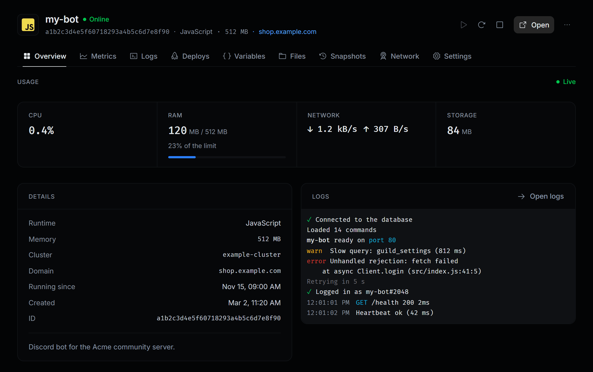
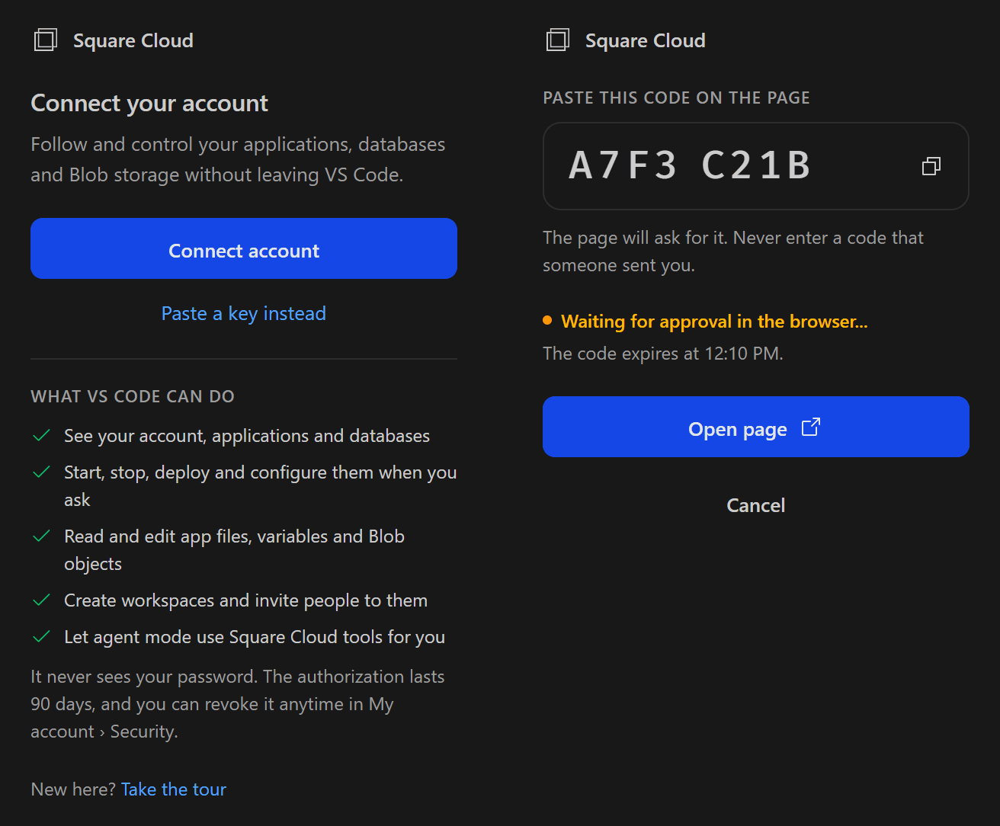
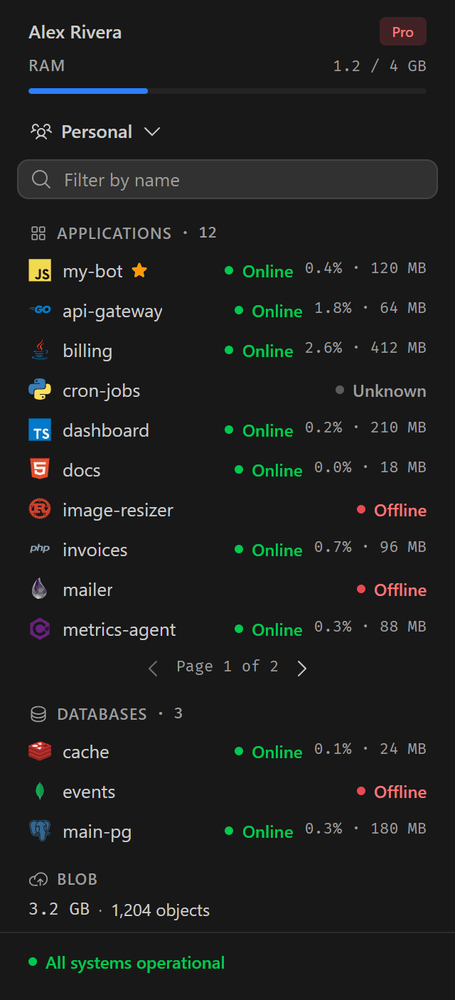
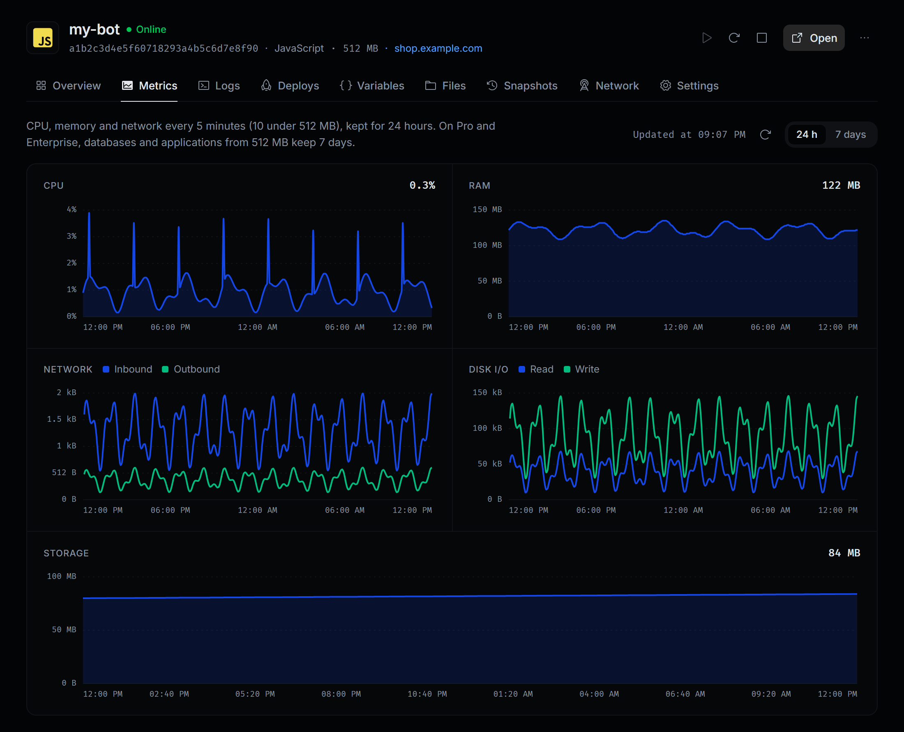
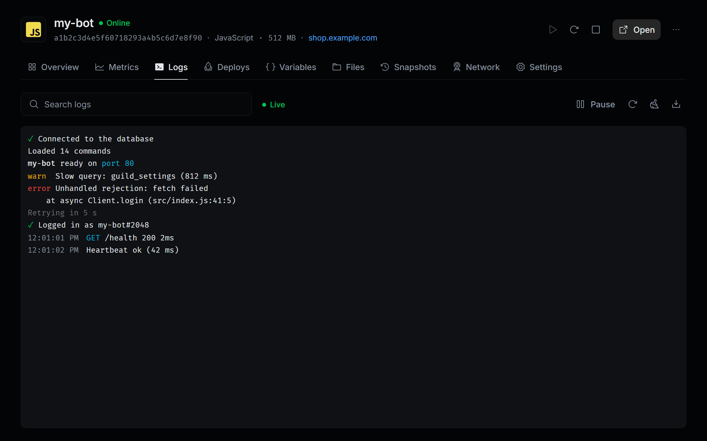
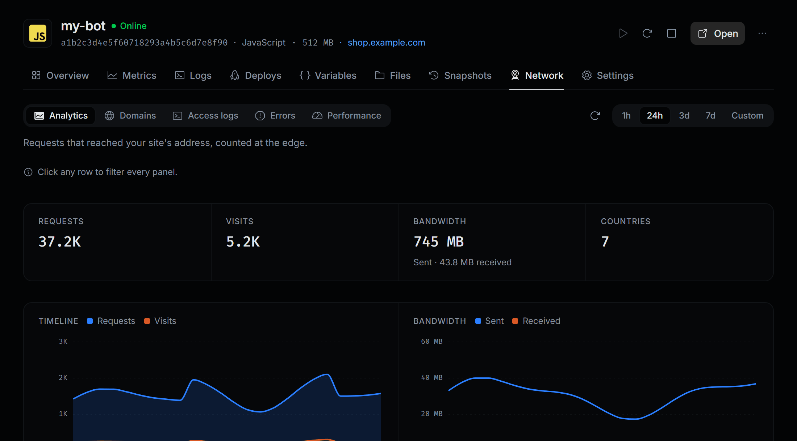
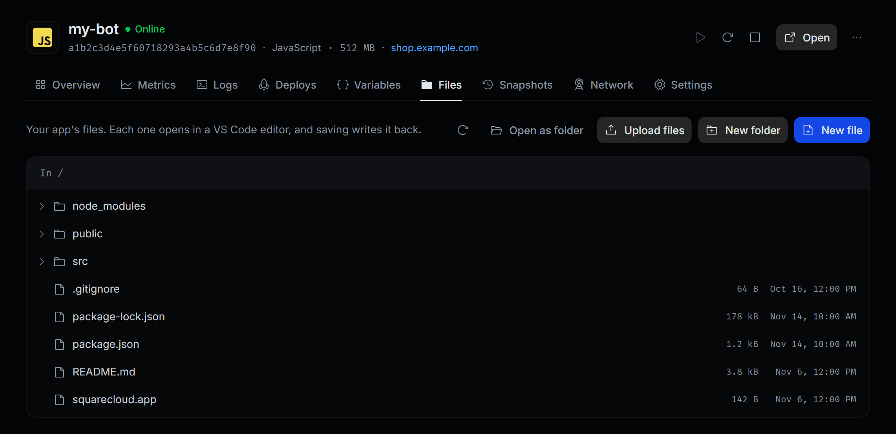
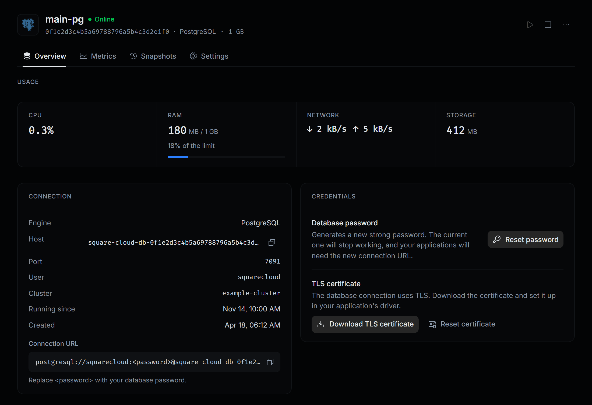
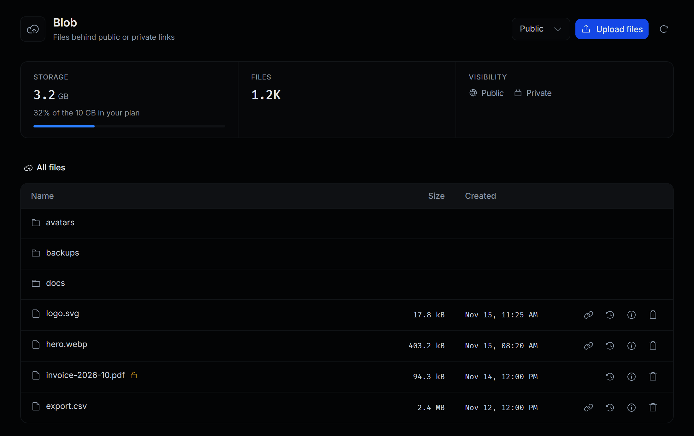
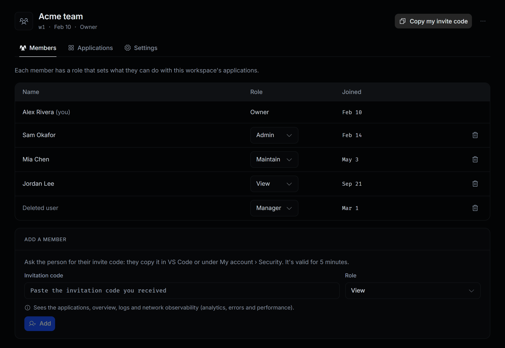

  

<h1 align="center">Square Cloud for VS Code</h1>

  Deploy, follow and configure your <a href="https://squarecloud.app" target="_blank">Square Cloud</a> applications, databases and Blob storage without leaving the editor.

  
  
  

  

## What it does

- **A sidebar for your whole account.** Applications and databases with their live status, your Blob storage, a workspace picker, favorites and the platform's status.
- **A panel for each resource.** An application, a database, a workspace or your Blob storage opens in an editor tab with everything you'd do on the website: metrics, logs, deploys, variables, files, snapshots, network and settings.
- **Your application's files in VS Code.** Open them in regular editors, and saving writes them back.
- **Upload and commit** a project folder, with the same ignore rules as the Square Cloud CLI.
- **IntelliSense for `squarecloud.app`:** completion, validation with quick fixes, and a hover that documents each key.
- **Square Cloud tools in agent mode.** The extension adds the Square Cloud MCP server to VS Code for you.

## Getting started

1. Install the extension and open the **Square Cloud** view in the activity bar.
2. Click **Connect account**. VS Code shows an 8-character code and opens the approval page in your browser: paste the code there and approve.
3. Your applications and databases show up in the sidebar. Click one to open its panel.

`Square Cloud: Get started` opens a ten-step walkthrough on the Welcome page with a button for each step.

## Sign-in and permissions

  

Connecting creates an authorization for VS Code only. It lasts 90 days, you can revoke it anytime in **My account › Security**, and VS Code never sees your password. It stays in VS Code's secret storage (your system keychain), and connecting or disconnecting in one window applies to all of them.

The authorization asks for these permissions:

| What VS Code can do | Scopes |
|---|---|
| See your account, applications and databases | `account:read`, `apps:read`, `databases:read`, `snapshots:read`, `envs:read` |
| Start, stop, deploy and configure them when you ask | `apps:control`, `apps:write`, `apps:deploy`, `snapshots:write`, `databases:write`, `databases:credentials`, `envs:write` |
| Read and edit application files and Blob objects | `files:read`, `files:write`, `blob:read`, `blob:write` |
| Create workspaces and invite people to them | `workspaces:manage` |
| Let agent mode use Square Cloud tools | `mcp` |

**Connected with 5.x?** That authorization doesn't cover files, Blob or agent mode. The Files tab offers **Reconnect**, the sidebar offers it for agent mode, and Blob shows up once you reconnect. Everything else keeps working.

**Paste a key instead** accepts an API key created in the dashboard, for machines without a browser.

## The sidebar

  

- **Account:** your plan and the RAM in use.
- **Workspace picker:** your own applications, or a workspace's. The menu also copies your invite code and opens the workspace's panel.
- **Applications and databases:** a status dot (Online, Offline, or amber while a start, stop or restart is on its way), CPU and RAM. Hover over a row to start, stop or restart it, click it to open its panel, and use ⋯ for the rest. Favorites stay at the top, a filter finds an application or database by name or ID, and long lists page 10 at a time.
- **Blob:** your storage use and object count, with a link to its panel.
- **Status:** the platform's status and any incidents or maintenance at the bottom, and a status bar item with your applications online.

The toolbar refreshes, uploads a new application and, under ⋯, creates a database or a workspace.

## Application panel

| Tab | What you can do |
|---|---|
| **Overview** | Live CPU, RAM, network and storage, the application's details, its latest logs, and start, restart and stop. |
| **Metrics** | CPU, RAM, network, disk and storage charts for the last 24 hours, or 7 days on Pro and Enterprise from 512 MB. |
| **Logs** | The latest lines, then new ones as they arrive. Search, pause, clear the view, reload or download. |
| **Deploys** | Link a GitHub repository and branch so every push deploys, or set a deploy webhook. The deploy history. |
| **Variables** | Environment variables with hidden values: reveal, add, edit, delete, paste a whole `.env` or import one from a file. |
| **Files** | Browse, open, create, rename, upload and delete files. **Open as folder** adds the application to your workspace. |
| **Snapshots** | Create, download as a `.zip` or restore a snapshot, and follow a restore step by step. |
| **Network** | For websites: traffic analytics with filters, domains and DNS records, access logs, errors, performance and cache purge. |
| **Settings** | Commit files or a folder, and delete the application (a recovery snapshot is taken first). |

  

  

  

Access logs and performance need a Pro or Enterprise plan; the tab says so when yours doesn't include them.

## Files

  

The Files tab and **Open as folder** use a file system of their own (`squarecloud://app/<application ID>/<path>`), so files open in regular editors with your theme, extensions and shortcuts, and **Save** writes them back to the application. A file can have up to 10 MB and a path up to 256 characters; send bigger files with a commit. Saving a file doesn't restart the application.

## Databases, workspaces and Blob

  

- **Database panel:** live usage, start and stop, the connection details and URL, the TLS certificate (download or reset), a new password, metrics, snapshots, the name and memory, and delete. `Square Cloud: Create database` creates a MongoDB, MySQL, PostgreSQL or Redis database and copies its connection URL once.
- **Workspace panel:** members and their roles, adding a member with their invite code, the shared applications, and leaving or deleting the workspace.
- **Blob panel:** browse by folder, upload as public or private with a picker or by dragging files in, copy a public link or a temporary one, delete, and see your storage use.

  

  

## Agent mode

With an account connected, the extension adds the [Square Cloud MCP server](https://docs.squarecloud.app/en/mcp/overview) (`https://mcp.squarecloud.app/mcp`) to VS Code. In agent mode you can ask in chat for an application's status, logs or metrics, or to restart it, and VS Code asks before each change. There's nothing to configure: the server uses your connected account. If you connected with 5.x or pasted a key, the sidebar offers to reconnect to allow it.

## Upload and commit

**Upload** (`Square Cloud: Upload new application`, or the toolbar's upload icon) creates an application from a folder:

1. Pick one of your workspace folders, or **Browse...**.
2. The folder needs a `squarecloud.app` or `squarecloud.config` file at its root, which tells Square Cloud how to run it.
3. Confirm, and the folder is zipped (up to 100 MB) without what the ignore rules leave out, then sent. You can cancel at any point.
4. The new application's panel opens.

**Commit** (the ⋯ menu, the palette or the Settings tab) sends files or a folder to an application you already have, keeping its ID, address and settings, and can restart it afterwards.

**Ignore rules.** `node_modules`, `.git`, `.github`, `.vscode` and the lockfiles `package-lock.json`, `pnpm-lock.yaml` and `yarn.lock` are left out by default. A `squarecloud.ignore` file at the folder's root adds rules with the `.gitignore` syntax, and a `!` rule brings a default back. `.gitignore` itself is not read: it often lists what the application needs, like `.env`. The Square Cloud CLI reads the same file the same way.

## The squarecloud.app file

- **Completion** for every key (Ctrl+Space) and for the values of `MAIN`, `MEMORY`, `VERSION`, `AUTORESTART` and `RUNTIME`.
- **Validation** as you type: required keys, lengths, a `MAIN` file that doesn't exist, a `MEMORY` below the minimum or above what your plan has available, and invalid `VERSION`, `RUNTIME`, `SUBDOMAIN` or `AUTORESTART` values, with quick fixes for the ones that have a fixed set of values.
- **Hover** over a key to see what it does, whether this file needs it, and a link to the [reference](https://docs.squarecloud.app/en/getting-started/config-file).
- Syntax highlighting for `squarecloud.app` and `squarecloud.config`, and file icons for those and `squarecloud.ignore`.

## Commands

Every command is under **Square Cloud:** in the command palette. The ones that end in `...` ask which application, database or workspace to use.

| Command | What it does |
|---|---|
| Connect account / Disconnect account | Sign in or out. |
| Get started | Opens the walkthrough. |
| Upload new application | Creates an application from a folder. |
| Refresh | Reloads the account now. |
| Start, Stop, Restart application... | Lifecycle. |
| Open application logs... / Follow application logs live... / Open application metrics... | Open the panel on that tab. |
| Commit files to application... | Sends files or a folder. |
| Download application snapshot... / Restore application snapshot... | Saves a new snapshot as a `.zip`, or opens the Snapshots tab. |
| Edit application environment variables... | Adds, edits or removes variables from a quick pick. |
| Link application to a GitHub repository... / Unlink application from its GitHub repository... | GitHub deploys. |
| Open website access logs... / errors... / performance... / Clear website cache... | The Network tab of a website. |
| Copy application ID... / Open application in the dashboard... / Delete application... | |
| Create database / Start database... / Stop database... / Delete database... | |
| Open database metrics... / Download database TLS certificate... | |
| Create workspace / Open workspace... / Copy my invite code | |
| Open Blob storage | The Blob panel. |
| Show service status | The platform's status. |

## Settings

| Setting | Default | Description |
|---|---|---|
| `squarecloud.favApps` | `[]` | IDs of your favorite applications, pinned to the top of the sidebar. **Add to favorites** in an application's ⋯ menu edits it for you. |

## Languages

English, Português (Brasil), Español, Deutsch, Français, Italiano, 日本語 and 简体中文, the languages of the Square Cloud website. VS Code picks one from its display language, and links to the website and the docs open in the same language.

## Requirements

- VS Code 1.125 or newer.
- A Square Cloud account with an active plan. Some features depend on the plan, such as 7 days of metrics, access logs and performance, and Blob; the panel says so when yours doesn't include one.

## Security and privacy

- The authorization covers only the scopes above, expires in 90 days and can be revoked in **My account › Security**.
- The sign-in code is shown in VS Code and typed on the approval page; it never travels in a URL. Never enter a code someone else sent you.
- A password reset in the database panel stays in memory until you reveal or copy it, and is gone once you close the panel. A downloaded certificate's private key is saved readable only by you.
- The extension talks only to Square Cloud, through the official [`@squarecloud/api`](https://github.com/squarecloudofc/sdk-api-js) and [`@squarecloud/blob`](https://github.com/squarecloudofc/sdk-blob-js) SDKs, plus a local loopback address during sign-in. No telemetry.

## Troubleshooting

- **The sidebar asks to connect again.** Authorizations last 90 days. Run `Square Cloud: Connect account`.
- **A tab says "Reconnect to use this".** Your authorization is older than that feature. Reconnect from the tab or the sidebar.
- **Upload says the config file is missing.** Add `squarecloud.app` at the root of the folder you upload.
- **Upload says the zip is too large.** Add build output, caches and dependencies to `squarecloud.ignore`.
- **Anything else.** `View → Output → Square Cloud` has the extension's log; include it when you report a bug.

## Contributing

Issues and pull requests are welcome in the [GitHub repository](https://github.com/squarecloudofc/vscode-extension). See [`CONTRIBUTING.md`](./CONTRIBUTING.md) to build, test and preview the extension.

## License

MIT. See [`LICENSE`](./LICENSE).
